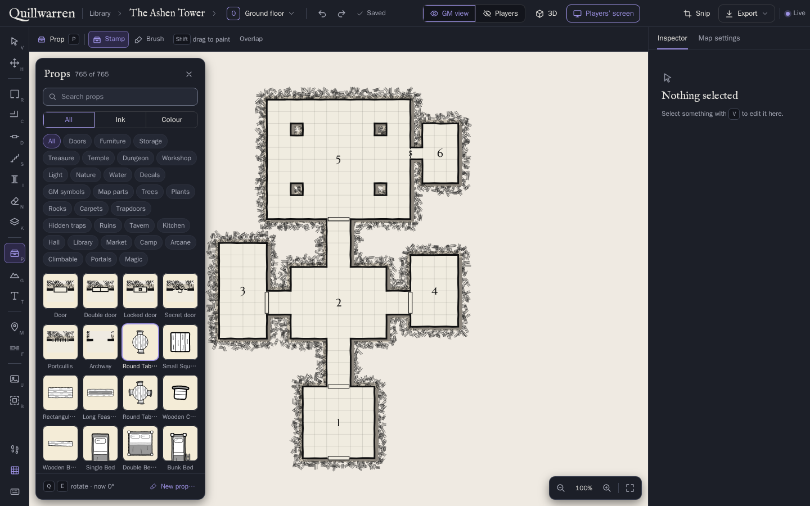

# Quillwarren

A self-hosted dungeon map editor for tabletop games. You draw maps in the browser, or let an AI build them: Claude (through MCP) or a local model edits the map while you watch every change happen live. Maps export as PNG for Roll20 and other virtual tabletops, and as a printable parchment handout for your players.



- **Editor:** rooms in any shape, corridors that find their own way, doors at any angle, stairs between storeys, pillars, terrain that fades into its neighbours, heights and cliffs, over 700 props in ink and colour, labels, GM markers and notes, fog of war, a 3D view of all storeys.
- **AI that edits live:** over 40 MCP tools that work by meaning ("a 6×4 room east of room 1, joined by a door"), so Claude Code, Claude Desktop or a small local model can build and fix maps. Every change is one undo step.
- **Exports:** PNG at 70 px per square for Roll20 (GM or players' version, whole map or cropped), SVG, Dungeon Scrawl `.ds`, and a parchment handout with a hand-drawn legend.
- **Two ways to run it:** a web server for you and your group (this README), or **Quillwarren for Windows**, a single-user desktop app with a built-in local model runtime ([docs/DESKTOP.md](docs/DESKTOP.md)).

## What you need

- **Node.js 24** or newer (Quillwarren uses `node:sqlite`).
- Linux or macOS for the build scripts (they are POSIX shell). The server itself is plain Node.
- Optional: [Claude Code](https://claude.com/claude-code) or Claude Desktop for the AI, or a local model server such as [Ollama](https://ollama.com).

## Tutorial: your first map in ten minutes

### 1. Get it and build it

```sh
git clone https://github.com/herades-sys/quillwarren.git quillwarren
cd quillwarren
npm ci
npm run build
```

`npm run build` makes `release/`: the bundled server (`release/main.mjs`), the browser code, fonts and assets. Everything it needs is inside that folder.

### 2. Make a password and an API token

The browser editor needs a password, and every change through the API (and MCP) needs a token.

```sh
npm run -s password-hash          # asks for a password (12+ characters), prints DELVE_EDIT_PASSWORD_HASH=…
openssl rand -hex 32              # any long random string works as the API token
```

Put both in an env file, for example `quillwarren.env` (keep it private, `chmod 600 quillwarren.env`):

```sh
DELVE_EDIT_PASSWORD_HASH=scrypt:16384:8:1:…   # the line password-hash printed
DELVE_API_TOKEN=…                              # the random string
```

### 3. Start the server

```sh
set -a; . ./quillwarren.env; set +a
PORT=8790 HOST=0.0.0.0 DELVE_DATA=./data node release/main.mjs
```

Open `http://<your-server's-IP>:8790/` from any computer on your network. `DELVE_DATA` is where your maps live (an SQLite database plus pictures and custom props); back up that folder. `GET /health` answers once the server runs.

Quillwarren answers to IP addresses, `localhost`, single-word names and home-network names (`.local`, `.lan`, `.home.arpa`…). If you reach it by another name, add it to `DELVE_ALLOWED_HOSTS` (see [docs/API.md](docs/API.md), "Access").

### 4. Log in and secure the login

1. Click **Log in to edit** and use the password from step 2.
2. The start page now says **Secure your login: create your admin account**. Choose a name and a password, scan the QR code with an authenticator app, type a code, and keep the 10 recovery codes somewhere safe.
3. From then on you log in with name, password and code. As admin you can add GM accounts for your friends under `/admin`.

### 5. Draw a map

1. On the start page press **N** (New map). Give it a name and pick a size for one square (5 ft by default).
2. Press **R** for the Room tool and drag a rectangle. The numbers 1–8 switch the shape (circle, hexagon, freehand…).
3. Draw a second room a few squares away. Press **C** (Corridor) and drag from one room to the other: the corridor routes itself.
4. Press **D** (Door) and click a wall to add a door. **S** adds stairs, **I** a pillar, **P** opens the props picker (a table with chairs, a chest, a brazier…), **G** paints terrain such as water or grass.
5. **V** selects; drag to move, **Q**/**E** turn, **Delete** removes, **Ctrl Z** undoes. Press **?** for every shortcut.
6. **Export → PNG for Roll20** saves the picture at 70 px per square. The **Players** switch shows what your players will see: room numbers, GM markers and secret doors are hidden.

### 6. Let Claude build one

Register Quillwarren's MCP endpoint with Claude Code (the token from step 2):

```sh
claude mcp add --transport http quillwarren http://<your-server's-IP>:8790/mcp --header "Authorization: Bearer <your API token>"
```

Open the map in your browser, then ask Claude Code something like:

> Create a map called "Crypt of Ash": an entrance hall 8×6, a corridor north to a round burial chamber with four pillars, and a small treasury east of it behind a locked door. Put a sarcophagus in the middle of the chamber, then render the map and check it.

You watch the rooms appear while Claude works, and it looks at the rendered picture to check its own work. To try a tool by hand: `DELVE_URL=http://127.0.0.1:8790 DELVE_API_TOKEN=… npm run mcp -- --list` lists them, and `npm run mcp -- list_maps '{}'` (same variables) calls one.

For a chat panel inside the browser editor, run the chat bridge as a user who is logged in to Claude Code (`node apps/server/src/cli/chat-bridge.ts`, listening on `127.0.0.1:8792`) and start the server with `DELVE_CHAT_URL=http://127.0.0.1:8792`. The bridge answers with that user's Claude Code login, so keep it for your own use. See [docs/API.md](docs/API.md), "Chat".

## Quillwarren for Windows

A desktop version for one person: no server, no login, maps in `%APPDATA%\Quillwarren`. Its chat can use a model on your own computer (a built-in llama.cpp runtime, or Ollama / LM Studio), Claude or OpenAI with your own API key, or Claude Desktop through a Quillwarren extension. Multiplayer is left out.

Download the installer from [the releases page](https://github.com/herades-sys/quillwarren/releases). The app isn't code-signed yet, so Windows SmartScreen shows "Windows protected your PC" the first time: click **More info**, then **Run anyway**.

Or build it yourself. To build the installer on Linux:

```sh
npm ci
(cd apps/desktop && npm ci)
sh apps/desktop/scripts/build.sh     # → apps/desktop/out/Quillwarren-Setup-<version>.exe and a portable zip
```

The script downloads the Windows Node.js runtime, resvg's Windows build and llama.cpp, each checked against a pinned checksum. The build isn't code-signed yet, so Windows SmartScreen will warn. Details: [docs/DESKTOP.md](docs/DESKTOP.md).

## Development

```sh
npm run typecheck
npm test                      # vitest, about 1400 tests
npm run build:web             # the browser bundles for a dev server
PORT=8791 HOST=127.0.0.1 DELVE_DATA=/tmp/delve-dev DELVE_API_TOKEN=dev-token node apps/server/src/main.ts
```

The server runs straight from the TypeScript sources on Node 24. `DELVE_INSECURE_OPEN_EDIT=1` treats every browser as logged in: only ever use it on `127.0.0.1` with throwaway data.

| Where | What |
|---|---|
| `packages/core` | the map model, operations and undo, geometry, the renderer (SVG), imports and exports; no Node or DOM APIs |
| `packages/table` | Quillwarren Table: the rules, dice and views for playing on a map with your group |
| `packages/ui` | the shared stylesheet, icons and page helpers |
| `apps/server` | Fastify: REST, WebSocket, MCP (`/mcp`), the pages, PNG export via resvg, the chat |
| `apps/web` | the browser editor, live viewer, 3D view, handout and Quillwarren Table client |
| `apps/desktop` | the Electron shell for Quillwarren for Windows |

More: [docs/API.md](docs/API.md) (REST, WebSocket, MCP, every feature), [docs/PLAN.md](docs/PLAN.md) (design and file formats), [docs/TABLE.md](docs/TABLE.md) (Quillwarren Table), [docs/DESKTOP.md](docs/DESKTOP.md) (the Windows app), [docs/UI.md](docs/UI.md) (the design system).

## Licence

Quillwarren is licensed under the [Apache License 2.0](LICENSE). Copyright 2026 herades-sys.

Third-party parts keep their own licences: the npm dependencies (listed with their texts in the Windows app's `THIRD-PARTY-NOTICES.txt`), the fonts IM FELL English and Marcellus SC (SIL Open Font License 1.1), and llama.cpp (MIT) in the Windows app. Quillwarren can import Dungeon Scrawl `.ds` files and Watabou city maps; it isn't affiliated with either.
